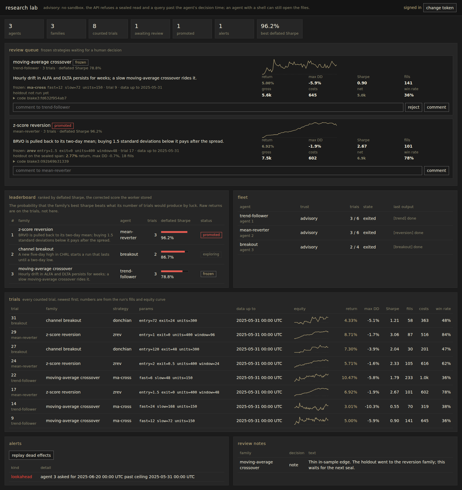

# h5i-db

<a href="https://github.com/h5i-dev/h5i-db/actions/workflows/ci.yml"></a>
<a href="https://pepy.tech/projects/h5i-db"></a>
<a href="https://github.com/h5i-dev/h5i-db/blob/main/LICENSE"></a>

[English](README.md) · [Español](README.es.md) · [Français](README.fr.md) · [简体中文](README.zh-CN.md) · **日本語**

**h5i-db** は、クオンツ研究のための組み込み型の時系列データベースとイベント駆動バックテスタです。

- **Pythonからバックテスト:** `pip install h5i-db` だけで、サーバーは不要です。毎秒305万イベントをリプレイし、どの実行もデータのバージョンに固定されます。
- **先読みが構造的に起きない:** 判断時刻を固定すれば、それより後の行はデータフレームに入りません。
- **実験が安い:** 各実行はデータベースの専用forkの中で動きます。パラメータスイープは試行ごとに1つのforkになり、データはコピーされず、アウトオブサンプルで順位付けされます。
- **ブラウザでレビュー:** `h5i-db ui` は試行、fork、バージョン、保留中の書き込みを1画面にまとめ、人の判断が要るものから順に並べます。

```bash
pip install h5i-db                              # Python library: database + backtester
cargo install h5i-db-cli                        # CLI and web UI
h5i-db ui market.db                             # review surface on 127.0.0.1:7351
npx skills add h5i-dev/h5i-db                   # agent skill (Claude Code, Codex, Cursor, …)
```

---

## 1. Pythonでバックテスト

```python
import h5i_db
from h5i_db import backtest

db = h5i_db.Database("market.db")

config = backtest.BacktestConfig(
    run_id="momentum-001",
    data=backtest.DataConfig(signals="signals", snapshot="2024-q1"),   # the pin
    portfolio=backtest.PortfolioConfig(starting_cash=100_000.0),
    execution=backtest.ExecutionConfig(fee_kind="kalshi", fee_rate=0.07),
    risk=backtest.RiskConfig(max_order_quantity=500.0),
)

backtest.inspect(db, config).raise_for_errors()  # refuse claims the data can't support
result = backtest.execute(db, config)            # replays inside fork "bt-momentum-001"

result.summary()                  # fills, final cash, how far it actually simulated
result.explain()                  # why orders were rejected or never filled
result.fills                      # Arrow, or just SQL it: SELECT * FROM bt_fills
result.tearsheet("run.html")
result.verify()                   # re-execute the stored config and compare
```

パラメータのグリッドは、試行ごとに1つのforkになります。学習期間とホールドアウト期間を渡すと、リーダーボードはアウトオブサンプルの成績で読めます:

```python
board = backtest.study(
    db, study_id="fees", base=config,
    parameters={"execution.fee_rate": [0.0, 0.02, 0.07]},
    validation=backtest.ValidationWindows(
        train=("2024-01-01", "2024-04-01"), holdout=("2024-04-01", "2024-07-01")
    ),
).leaderboard("holdout_final_cash")
```

- **取引所:** Kalshi、Polymarket、Hyperliquid、Binance、Limitless、Opinion、Manifold、それに任意のOHLCVや約定のダンプ。ローダーは手元にあるファイルを読むだけです。詳しくは[取引所ガイド](crates/h5i-db-venues/README.md)を参照してください。
- **統計:** `alphalens`・`empyrical` と一致するファクターとパフォーマンス指標に加えて、deflated Sharpeとバックテスト過剰適合確率。
- **データの出し入れ:** `db.append`、`db.sql(...)`、時系列SQL(ASOF join、`time_bucket`、`vwap`、移動窓)、そして `db.read(..., version=n)` による過去バージョンの読み取り。

---

## 2. リサーチラボ

`apps/lab/demo.sh` を実行すると、Docker上のPostgreSQL、合成した市場データ、スクリプトで動く3体のエージェントとともに、127.0.0.1:8202 でラボが起動します(止めるときは `apps/lab/demo.sh down`)。自分のデータで動かす方法は [apps/lab/README.md](apps/lab/README.md) にあります。

- **レビューキュー:** 凍結された戦略を、コード、パラメータ、エクイティカーブ、コスト、ホールドアウトの結果とともに表示し、promote、却下、コメントができます。
- **リーダーボード:** ファミリーをデフレーテッド・シャープ・レシオで順位付けします。この値はファミリーが試す変種が増えるほど下がります。生のリターンは試行の側にだけ表示されます。
- **試行:** 数えられたすべての実行について、リターン、最大ドローダウン、シャープ・レシオ、約定数、コスト、エクイティのスパークラインを表示します。どれもエンジンの約定から計算した値です。
- **アラート:** 判断時刻より後の読み取り、拒否されたバックテスト、使用済みのホールドアウト。

<p align="center">
  
</p>

---

## 3. ドキュメント

- [マニュアル](https://db.h5i.dev/manual/): [バックテスト](https://db.h5i.dev/manual/backtest/)、[クオンツ](https://db.h5i.dev/manual/quant/)、[CLI](https://db.h5i.dev/manual/cli/)、[ノートブック](https://db.h5i.dev/manual/notebooks/)
- [Python API](https://db.h5i.dev/api/) · [クックブック](https://github.com/h5i-dev/h5i-db-cookbook) · [エージェント向けskill](skills/h5i-db/SKILL.md)
- [ベンチマーク](docs/BENCHMARKS.md): DuckDB、Polars、ArcticDB、NautilusTrader、LEANとの比較
- [h5i-dbを選ぶ理由](docs/OVERVIEW.md): エージェントにとっての利点と、使うべきでない場面
- [開発](docs/DEVELOPMENT.md) · [設計](DESIGN.md) · [運用](docs/OPERATIONS.md) · [ロードマップ](docs/ROADMAP.md)

---

## 4. ライセンス

Apache-2.0。[LICENSE](./LICENSE) を参照してください。
